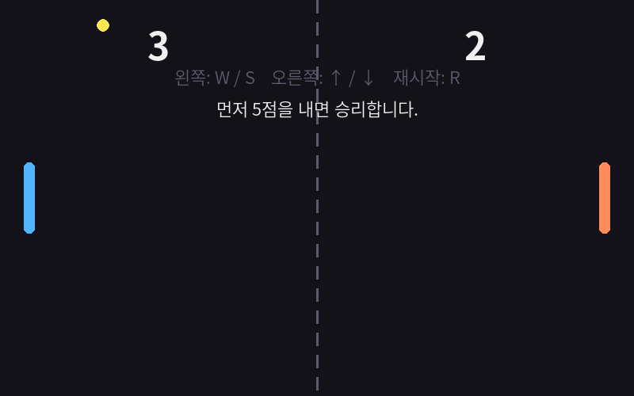

> 놀이 속 규칙을 알고리즘으로, 알고리즘을 파이썬 코드로!

## 이 책은 이런 분께

- 파이썬을 처음 배우는 고등학생
- 「정보」 '알고리즘과 프로그래밍' 단원을 프로젝트 수업으로 운영하고 싶은 선생님
- 텍스트 게임에서 그래픽 게임(pygame)까지 한 흐름으로 가르치고 싶은 연수 참여자

## 왜 게임인가?

게임은 **규칙이 분명하고**, 학생에게 **친숙하며**, 결과를 **바로 확인**할 수 있습니다. 업다운 게임 하나에도 입력 검사, 조건 분기, 반복, 기록, 이진 탐색까지 들어 있습니다. 이 책의 목표는 게임을 '많이 만드는 것'이 아니라, 게임 규칙을 **분해하고 모델링하여 코드로 옮기는 과정**을 익히는 것입니다.

## 각 차시 페이지의 구성

| 순서 | 내용 |
| --- | --- |
| 학습 목표 · 핵심 질문 | 이번 시간에 무엇을 왜 배우는지 |
| 핵심 개념 | 게임 코드에서 뽑은 핵심 코드와 설명 |
| 실습 활동 | 따라 하기 · 바꿔 보기 · 설계하기 (활동지 연결) |
| 확인 퀴즈 | 5문항 (정답은 부록 06-1) |
| 코딩 테스트 | 기본 1 + 도전 1, 예제 입출력 제공 (정답 코드는 부록·GitHub) |
| 자료 내려받기 | 소스코드, PPT, 활동지 링크 |

## 저자와 저작권

- 김동균(현 김해수남고등학교 정보교사, 전 대구과학고등학교·대구SW마이스터고등학교 교사)
- 수업·연수 목적의 비영리 활용을 환영합니다. 활용할 때는 출처를 밝혀 주세요.
- 소개 블로그: [https://blog.naver.com/nabilera1/100020953719](https://blog.naver.com/nabilera1/100020953719)

## 읽는 순서

[00-1]에서 수업 모형을, [00-2]에서 개발 환경을, [00-3]에서 자료 내려받는 법을 확인한 뒤 1차시부터 차례로 학습합니다.
