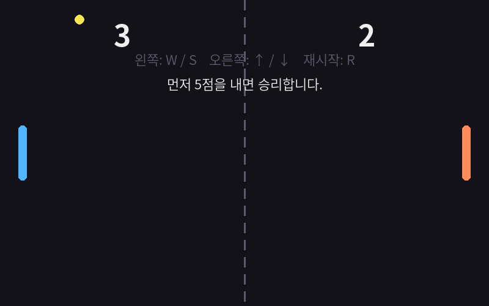

> **4부 클래스로 만드는 핑퐁 게임** · 13차시 · 6단계 모형: **구현**  
> 게임: 핑퐁 게임 미리 보기 · Paddle 클래스 읽기  
> 핵심 개념: 클래스, 객체(인스턴스), 속성, 메서드, __init__, self, 상수, 모듈

## 학습 목표

1. 클래스와 객체, 속성과 메서드의 관계를 설명할 수 있다.
2. __init__과 self를 사용하여 클래스를 정의하고 객체를 여러 개 만들 수 있다.
3. 핑퐁 게임을 구성하는 객체(패들, 공, 점수판, 게임)를 찾아 설계할 수 있다.

## 핵심 질문

> **패들 2개, 공 1개, 점수판 1개… 비슷한 것을 여러 개 만들 때 코드를 어떻게 묶어야 할까?**

이제부터는 그래픽 **핑퐁 게임**을 만듭니다. 화면에는 왼쪽 패들, 오른쪽 패들, 공, 점수판이 있습니다. 왼쪽과 오른쪽 패들은 **색과 조작 키만 다르고 하는 일은 똑같습니다.**

이럴 때 **클래스**(설계도)를 하나 만들고, 그 설계도로 **객체**(실제 물건)를 여러 개 찍어 냅니다. 붕어빵 틀(클래스) 하나로 팥 붕어빵, 슈크림 붕어빵(객체)을 만드는 것과 같습니다.



## 클래스 · 객체 · 속성 · 메서드

| 용어 | 뜻 | 핑퐁 게임 예 |
| --- | --- | --- |
| 클래스 | 설계도 | `Paddle`, `Ball`, `Scoreboard`, `Game` |
| 객체(인스턴스) | 설계도로 만든 실물 | `left_paddle`, `right_paddle` |
| 속성 | 객체가 가진 정보 (변수) | `rect`(위치·크기), `color`, `keys`, `speed` |
| 메서드 | 객체가 할 수 있는 일 (함수) | `handle_input()`, `draw()` |

```text
         Paddle (클래스 = 붕어빵 틀)
        ┌──────────────────────────┐
        │ 속성: rect, color, keys   │
        │ 메서드: handle_input, draw│
        └──────────────────────────┘
              │               │
     left_paddle            right_paddle      ← 객체 2개
   하늘색, W/S 키          주황색, ↑/↓ 키
```

## 가장 작은 클래스 만들기

```python
class Player:                          # 클래스 이름은 대문자로 시작
    def __init__(self, name, hp=30):   # 객체를 만들 때 자동 실행되는 준비 함수
        self.name = name               # self.속성 = 값 → 객체마다 따로 저장
        self.hp = hp

    def damage(self, amount):          # 메서드: 첫 매개변수는 항상 self
        self.hp = max(0, self.hp - amount)

    def alive(self):
        return self.hp > 0

a = Player("용사")          # 객체 생성 → __init__(self=a, name="용사")
b = Player("마법사", 20)
a.damage(12)
print(a.name, a.hp, a.alive())   # 용사 18 True
print(b.name, b.hp)              # 마법사 20  ← b 는 영향 없음
```

`self`는 "**지금 이 메서드를 부른 바로 그 객체**"입니다. `a.damage(12)`를 부르면 self는 a, `b.damage(5)`를 부르면 self는 b가 됩니다.

12차시의 `@dataclass class Player`는 이 `__init__`을 파이썬이 자동으로 만들어 주는 간단한 방법이었습니다.

## 핑퐁 게임의 Paddle 클래스

```python
class Paddle:
    def __init__(self, x, y, color, keys):
        self.rect = pygame.Rect(x, y, PADDLE_WIDTH, PADDLE_HEIGHT)
        self.color = color
        self.keys = keys            # {"up": 키, "down": 키}
        self.speed = PADDLE_SPEED

    def draw(self, screen):
        pygame.draw.rect(screen, self.color, self.rect, border_radius=6)

# game.py 에서 객체 2개 생성
left_paddle = Paddle(x=30, y=205, color=LEFT_COLOR,
                     keys={"up": pygame.K_w, "down": pygame.K_s})
right_paddle = Paddle(x=756, y=205, color=RIGHT_COLOR,
                      keys={"up": pygame.K_UP, "down": pygame.K_DOWN})
```

## 파일 나누기: 모듈과 상수

핑퐁 게임은 역할별로 파일(모듈)이 나뉘어 있습니다.

| 파일 | 역할 | 비유 |
| --- | --- | --- |
| `main.py` | 게임 시작 | 시작 버튼 |
| `game.py` | 전체 흐름 관리 (`Game`) | 감독 |
| `paddle.py` | 패들 (`Paddle`) | 선수 |
| `ball.py` | 공 (`Ball`) | 공 |
| `scoreboard.py` | 점수와 안내 (`Scoreboard`) | 전광판 |
| `constants.py` | 화면 크기·색·속도 | 설정표 |

```python
# constants.py — 대문자 이름 = 바뀌지 않는 값(상수)이라는 약속
SCREEN_WIDTH = 800
BALL_SPEED = 6

# 다른 파일에서 가져오기
from constants import SCREEN_WIDTH, BALL_SPEED
```

공을 빠르게 하고 싶으면 `constants.py`의 숫자 하나만 바꾸면 됩니다.

## 실습 활동

1. `Player` 클래스에 `heal(amount)` 메서드를 추가하세요. 체력은 최대 30을 넘지 않아야 합니다.
2. 핑퐁 게임 폴더를 내려받아 `pip install pygame` 후 `python main.py`로 실행해 보세요.
3. `constants.py`에서 `PADDLE_HEIGHT`, `BALL_SPEED`, `WIN_SCORE`를 바꿔 보고 게임이 어떻게 달라지는지 기록하세요.

활동지: [ws13-class-object.md](https://github.com/nabilera1/python_lecture_game_pingpong/blob/main/worksheets/ws13-class-object.md)

## 확인 퀴즈

**Q1.** 클래스로부터 만들어진 실체를 무엇이라 하는가?

- ① 모듈
- ② 객체(인스턴스)
- ③ 매개변수
- ④ 상수

**Q2.** 객체를 만들 때 자동으로 실행되는 메서드는?

- ① __main__
- ② __init__
- ③ start
- ④ self

**Q3.** `a = Player("A")`, `b = Player("B")` 후 `a.damage(5)`를 실행하면?

- ① a와 b의 hp가 모두 줄어든다
- ② a의 hp만 줄어든다
- ③ b의 hp만 줄어든다
- ④ 오류

**Q4.** `self`에 대한 설명으로 옳은 것은?

- ① 클래스 이름이다
- ② 메서드를 호출한 그 객체를 가리킨다
- ③ 전역 변수이다
- ④ 생략하면 자동으로 붙는다

**Q5.** `constants.py`에 설정값을 모아 두는 가장 큰 이유는?

- ① 실행 속도가 빨라진다
- ② 한 곳만 고치면 게임 전체에 적용된다
- ③ 오류가 나지 않는다
- ④ pygame이 요구한다

## 코딩 테스트

각 문제의 입력 형식을 지켜 `input()`으로 읽고, 출력 형식과 **똑같이** 출력하세요.

### 문제 1. Player 클래스 명령 처리 (기본)

hp(최대 30)를 가진 `Player` 클래스를 만들고 `damage(n)`, `heal(n)` 메서드를 구현하세요. hp는 0 미만, 30 초과가 될 수 없습니다. 첫째 줄에 명령 개수 n, 다음 n줄에 `damage 숫자` 또는 `heal 숫자`가 주어집니다. 모든 명령 후 hp를 출력하고, 0이면 둘째 줄에 `GAME OVER`를 출력하세요.

- 입력: n, n줄의 명령
- 출력: 최종 hp (0이면 GAME OVER 추가)

예제 입력 1

```text
3
damage 12
heal 50
damage 7
```

예제 출력 1

```text
23
```

예제 입력 2

```text
2
damage 25
damage 10
```

예제 출력 2

```text
0
GAME OVER
```

### 문제 2. 두 객체를 따로 관리하기 (도전)

이름과 점수를 가진 `Team` 클래스를 만들고 `add_point()` 메서드를 구현하세요. 첫째 줄에 두 팀 이름, 둘째 줄에 득점한 팀 이름들이 공백으로 주어질 때, 두 팀의 `이름 점수`를 한 줄씩 출력하고 마지막 줄에 승자(같으면 `무승부`)를 출력하세요.

- 입력: 팀 이름 2개, 득점 기록
- 출력: 각 팀 점수와 승자

예제 입력 1

```text
blue orange
blue orange blue blue
```

예제 출력 1

```text
blue 3
orange 1
blue
```

예제 입력 2

```text
A B
A B
```

예제 출력 2

```text
A 1
B 1
무승부
```

정답과 해설은 **[부록] 06-1-13. 13차시 정답과 해설** 페이지([GitHub에서 보기](https://github.com/nabilera1/python_lecture_game_pingpong/blob/main/pages/06-1-13-answer.md))에 있습니다. 먼저 스스로 풀어 본 뒤 확인하세요.

## 정리

- 클래스 = 설계도, 객체 = 실물
- 속성(self.변수) + 메서드(함수)
- __init__: 생성 시 자동 실행, self: 호출한 그 객체
- 핑퐁 = Game이 Paddle×2, Ball, Scoreboard를 지휘

## 자료 내려받기

| 자료 | 링크 |
| --- | --- |
| 소스코드 `paddle.py` | [paddle.py 보기](https://github.com/nabilera1/python_lecture_game_pingpong/blob/main/source/pingpong/paddle.py) · [내려받기(Raw)](https://raw.githubusercontent.com/nabilera1/python_lecture_game_pingpong/main/source/pingpong/paddle.py) |
| 소스코드 `constants.py` | [constants.py 보기](https://github.com/nabilera1/python_lecture_game_pingpong/blob/main/source/pingpong/constants.py) · [내려받기(Raw)](https://raw.githubusercontent.com/nabilera1/python_lecture_game_pingpong/main/source/pingpong/constants.py) |
| 소스코드 `10_dungeon.py` | [10_dungeon.py 보기](https://github.com/nabilera1/python_lecture_game_pingpong/blob/main/source/text_games/10_dungeon.py) · [내려받기(Raw)](https://raw.githubusercontent.com/nabilera1/python_lecture_game_pingpong/main/source/text_games/10_dungeon.py) |
| 학습용 PPT | [13-class-object.pptx 내려받기](https://github.com/nabilera1/python_lecture_game_pingpong/raw/main/slides/13-class-object.pptx) |
| 학생 활동지 | [ws13-class-object.md](https://github.com/nabilera1/python_lecture_game_pingpong/blob/main/worksheets/ws13-class-object.md) |
| 코딩 테스트 1 정답 코드 | [ch13_test1.py 보기](https://github.com/nabilera1/python_lecture_game_pingpong/blob/main/source/solutions/ch13_test1.py) · [내려받기(Raw)](https://raw.githubusercontent.com/nabilera1/python_lecture_game_pingpong/main/source/solutions/ch13_test1.py) |
| 코딩 테스트 2 정답 코드 | [ch13_test2.py 보기](https://github.com/nabilera1/python_lecture_game_pingpong/blob/main/source/solutions/ch13_test2.py) · [내려받기(Raw)](https://raw.githubusercontent.com/nabilera1/python_lecture_game_pingpong/main/source/solutions/ch13_test2.py) |
| 전체 자료 한 번에 | [ZIP 내려받기](https://github.com/nabilera1/python_lecture_game_pingpong/archive/refs/heads/main.zip) |
